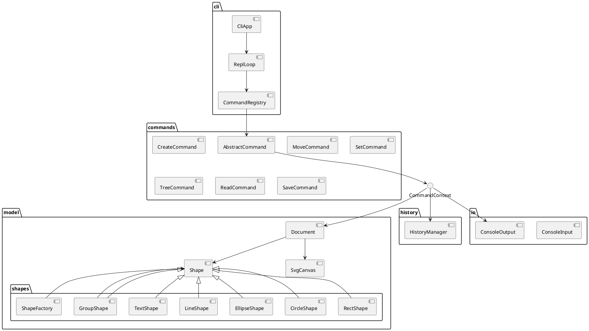

# Architecture and Phase 1 Summary

## 1. 模块划分

The project is organized into a compact layered structure that keeps the CLI, command logic, document model, and terminal I/O separated.

- `src/cli`: terminal interaction, REPL, and command dispatch.
- `src/commands`: command objects for create / move / set / delete / group / read / save / undo / redo.
- `src/model`: core SVG document state, tree-based shape lookup, canvas sizing, and serialization.
- `src/model/shapes`: concrete SVG primitives and the centralized factory.
- `src/history`: undo/redo stack for reversible edits.
- `src/io`: console adapters that isolate terminal code.
- `doc`: design decisions and process records.
- `test`: smoke tests and tree-model checks.

## 2. 设计模式的选择

### Command Pattern
Each executable action is implemented as a class with the same command interface and is registered centrally in `CommandRegistry` instead of using a monolithic `switch` in the REPL.

### Composite Pattern
`Shape` and `GroupShape` form the composite structure for SVG. Container nodes and leaf nodes share a single abstraction, which lets operations such as move, delete, and scale work on nested trees as a uniform model.

### Factory Pattern
`ShapeFactory` is the single creation point for built-in SVG shapes. It centralizes the name-to-class mapping and creates a natural extension point for future shape types.

## 3. 依赖方向规则

- `cli` may depend on `commands`, `model`, and `io`.
- `commands` may depend on `model`, `history`, and `io`.
- `model` must not depend on `cli` or `commands`.
- `io` is a technical adapter and should not own business logic.

This is consistent with the requirement to keep the document and shape model independent from the terminal interface.

## 4. 变化点假设

1. Shape kinds and geometry
   - Future graphical primitives will likely be added.
   - The current `Shape` and `ShapeFactory` boundary is the extension point.

2. SVG serialization and round-trip fidelity
   - File save/read and XML parsing may become more strict over time.
   - The model already owns this behavior through `Document.serializeSvg()` and `Document.deserializeSvg()`.

3. Undo/redo and structural mutation
   - More complex tree edits may require richer reverse state.
   - The current `HistoryManager` is intentionally minimal but keeps the command-based undo contract explicit.

## 5. 过程记录

The most important architectural correction in this phase was the shift from the earlier Map-based lookup idea to the final tree-first model. At one point, the document model carried a convenience lookup structure alongside the recursive tree, which created a second source of truth: the in-memory model could be traversed through the SVG tree, but a separate map introduced a hidden risk of drift and inconsistency. We explicitly treated that as a design tension rather than silently accepting it. The final decision was to make the SVG tree the authoritative state and keep `findById()` as a tree traversal helper rather than a parallel index. This made child/parent relationships, nested group operations, and move/scale semantics consistent with the actual DOM-like structure of SVG.

The process also included a concrete Git verification correction. At one point, the AI relied on a single `git push` terminal output and concluded that the complete Phase 1 implementation had been synchronized to GitHub. A human check of the remote then showed that the remote still only had the older skeleton history. We subsequently re-verified with `git rev-parse HEAD`, `git rev-parse origin/main`, `git status`, and `git log`, and also inspected the real file contents. The result was clear: the full Phase 1 implementation was still only present as working-tree modifications and had not entered any commit. That corrected the earlier conclusion and established the rule that Git status is judged using the combined evidence of commit state, remote-tracking refs, and the working tree, rather than a single terminal output alone.

This phase therefore documents the key AI collaboration pattern: identify the tension, validate it with actual code and Git facts, then reduce the architecture to a consistent design before claiming completion.

## 6. 一致性自查

### 模块划分
The current directory structure is consistent with the architecture described above. The CLI is separate from the document model, the shape hierarchy remains central, and the history layer remains a dedicated boundary.

### 依赖方向
The checked code keeps the dependency direction aligned with the rules above. No command or CLI file owns the shape model directly.

## 7. 质量保证手段

The project’s quality assurance is based on the actual validation commands that were executed for this Phase 1 implementation, not on a generic smoke-only story.

- TypeScript build: `npm run build` ensures the project compiles cleanly.
- CLI smoke test: the startup path is validated by running the REPL with `help` and `exit`, confirming the banner, command list, and clean shutdown.
- `test/phase1-validation.ts`: this is the main functional acceptance script for the Phase 1 behavior. It exercises the real CLI and asserts the required semantics for:
  - composite `move` and `scale` on a `g` container and nested child nodes;
  - `undo` and `redo` behavior;
  - the IO barrier after `save` / `read` / `init` / `canvas`, where undo is disallowed and a later edit remains valid;
  - invalid positive-scale rejection (`scale factor must be positive`) without mutating state;
  - `set` attribute whitelist enforcement and unknown attribute rejection;
  - SVG `read` auto-id assignment and warning output for unnamed elements;
  - tree-based nested ID lookup.

This validation covers the real milestones expected by the assignment: tree model correctness, command behavior, composite mutation, undo/redo semantics, IO boundary rules, and file round-trip safety. The result is a concrete assurance that the implementation is functionally complete for Phase 1 rather than merely compiling or starting successfully.
