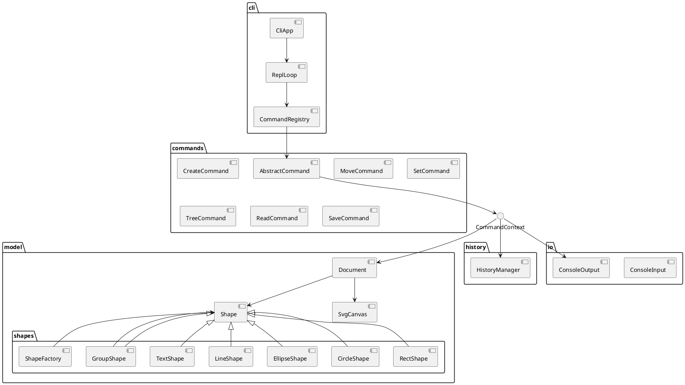

# Architecture and Phase 1 Summary

## 1. 模块划分

The project is organized into a compact layered structure that keeps the CLI, command logic, document model, and terminal I/O separated.

- `src/cli`: terminal interaction, REPL, and command dispatch.
- `src/commands`: command objects for create / move / set / delete / group / read / save / undo / redo.
- `src/model`: core SVG document state, tree-based shape lookup, canvas sizing, and serialization.
- `src/model/shapes`: concrete SVG primitives and the centralized factory.
- `src/history`: undo/redo stack for reversible edits.
- `src/io`: console adapters that isolate terminal code.
- `doc`: design decisions and process records.
- `test`: smoke tests and tree-model checks.

## 2. 设计模式的选择

### Command Pattern
Each executable action is implemented as a class with the same command interface and is registered centrally in `CommandRegistry` instead of using a monolithic `switch` in the REPL.

### Composite Pattern
`Shape` and `GroupShape` form the composite structure for SVG. Container nodes and leaf nodes share a single abstraction, which lets operations such as move, delete, and scale work on nested trees as a uniform model.

### Factory Pattern
`ShapeFactory` is the single creation point for built-in SVG shapes. It centralizes the name-to-class mapping and creates a natural extension point for future shape types.

## 3. 依赖方向规则

- `cli` may depend on `commands`, `model`, and `io`.
- `commands` may depend on `model`, `history`, and `io`.
- `model` must not depend on `cli` or `commands`.
- `io` is a technical adapter and should not own business logic.

This is consistent with the requirement to keep the document and shape model independent from the terminal interface.

## 4. 变化点假设

1. Shape kinds and geometry
   - Future graphical primitives will likely be added.
   - The current `Shape` and `ShapeFactory` boundary is the extension point.

2. SVG serialization and round-trip fidelity
   - File save/read and XML parsing may become more strict over time.
   - The model already owns this behavior through `Document.serializeSvg()` and `Document.deserializeSvg()`.

3. Undo/redo and structural mutation
   - More complex tree edits may require richer reverse state.
   - The current `HistoryManager` is intentionally minimal but keeps the command-based undo contract explicit.

## 5. 过程记录

The main architectural correction during this phase was to avoid a second authoritative shape registry. The project uses the SVG tree as the source of truth for lookup and mutation, and the model is intentionally built around that design rather than a separate parallel map.

The command layer was then expanded to cover the core Phase 1 operations and the smoke validation loop was kept focused on real, observable behavior: CLI startup, command registration, and basic model traversal.

## 6. 一致性自查

### 模块划分
The current directory structure is consistent with the architecture described above. The CLI is separate from the document model, the shape hierarchy remains central, and the history layer remains a dedicated boundary.

### 依赖方向
The checked code keeps the dependency direction aligned with the rules above. No command or CLI file owns the shape model directly.

## 7. 质量保证手段

The project verifies correctness through a small but relevant validation loop:

- `npm test` for build and smoke validation.
- CLI startup check via `help` and `exit`.
- tree-based lookup tests for nested IDs.
- design documentation that records architectural rules and prevents silent drift.

This keeps the implementation aligned with the Lab 1 requirements without overbuilding the project beyond the phase boundary.
