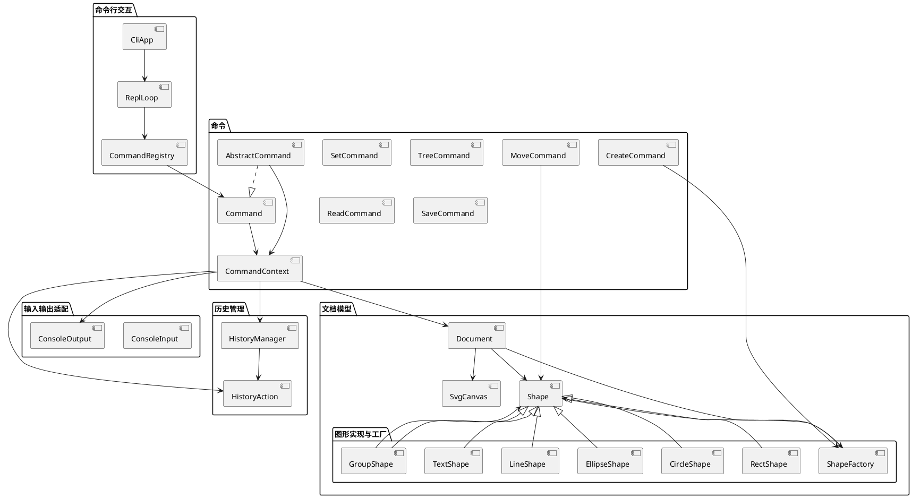
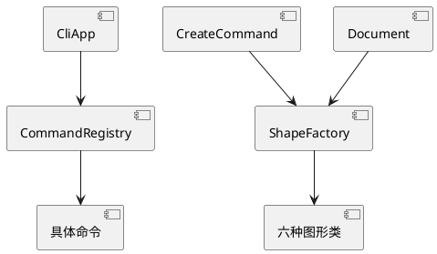
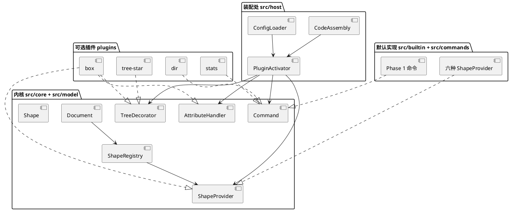

# SVG 编辑器：Lab 1 项目报告

第 1—7 节记录 `final` 对应的 Phase 1 方案与结果；它们保留当时的设计判断。第 8 节起记录 Phase 2 的实际重构状态，若两阶段的“当前实现”描述不同，以 Phase 2 小节为准。

## 1. 模块划分

本项目按职责划分为命令行交互、命令、文档模型、历史管理和输入输出适配等模块。这样做的主要目的是把终端交互和核心 SVG 编辑逻辑分开，避免所有功能都集中在一个类中。



各目录的职责如下：

- `src/cli`：负责终端交互、REPL 循环和命令分发。
- `src/commands`：实现创建、移动、缩放、属性修改、删除、分组、文件读写、撤销和重做等命令。
- `src/model`：维护 SVG 文档状态、画布信息、图形树和序列化逻辑。
- `src/model/shapes`：实现具体图形类以及图形工厂。
- `src/history`：维护撤销栈和重做栈。
- `src/io`：封装控制台输入输出。
- `doc`：保存项目报告、设计决策和开发记录。
- `test`：保存模型测试、命令状态测试和 CLI 验收测试。

整体依赖方向可以概括为：

```text
CLI
 ↓
Command
 ↓
Model

History ← Command
IO      ← Command / CLI
```

命令行层负责组装 `Document`、`HistoryManager` 和输出通道，并把它们放入 `CommandContext`。具体命令负责参数验证和编辑流程，真正的文档和图形状态由 Model 管理。

文件读写目前由 `ReadCommand` 和 `SaveCommand` 调用文件系统完成，`src/io` 主要负责控制台适配。Model 不依赖 CLI、终端或文件系统。

---

## 2. 设计模式的选择

### 2.1 Command 模式

本项目要求支持 `undo/redo`，因此编辑操作采用 Command 模式比较自然。

每个操作都实现统一的命令接口，并集中注册到 `CommandRegistry`。这样 REPL 只负责根据命令名找到对应 Command，而不会直接包含大量具体编辑逻辑。

撤销和重做通过 `HistoryAction` 保存操作需要恢复的信息。例如：

- `set` 保存修改前后的属性值；
- 结构编辑保存原父节点和原同级位置；
- 移动和缩放保存局部几何状态。

这样做比每次复制整个 SVG 文档更轻量，也能让每个命令自己负责如何撤销自己的修改。

### 2.2 Composite 模式

SVG 本身就是树形结构，`<g>` 可以包含其他图形，因此项目中把 `GroupShape` 也设计成一种 `Shape`。

```text
Shape
├── RectShape
├── CircleShape
├── EllipseShape
├── LineShape
├── TextShape
└── GroupShape
    └── Shape[]
```

`MoveCommand` 和 `ScaleCommand` 只调用统一的：

```ts
shape.move(...)
shape.scale(...)
```

叶子图形修改自己的几何属性，而 `GroupShape` 负责递归对子节点执行操作。

这样调用方不需要到处判断“当前目标到底是普通图形还是 Group”，也更符合 Composite 模式的设计目的。

### 2.3 Factory 模式

图形创建集中在 `ShapeFactory` 中。

`ShapeFactory.create()` 负责从类型名创建对应图形，SVG 读入时也通过 `ShapeFactory.fromSvg()` 转换属性并复用创建逻辑。

这样可以避免 `rect / circle / line ...` 的类型分派散落在 CLI、Command 和 Document 中。

---

## 3. 依赖方向规则

项目中约定以下依赖方向：

- CLI 可以依赖 Command、Model、History 和 IO。
- Command 可以依赖 Model、History 和 IO。
- Model 不依赖 CLI、Command、控制台或文件系统。
- History 只管理 `HistoryAction`，不依赖具体 Command。
- IO 只负责技术层面的输入输出，不包含业务逻辑。

这样做的好处是，核心图形和文档逻辑不需要启动终端就可以测试，也方便以后替换交互方式。

目前仍有一个明确的边界：`CommandContext` 直接依赖 `ConsoleOutput`。如果后续真的增加 GUI 或 Agent 输入通道，可以再把输出进一步抽象成更通用的接口。Phase 1 暂时不提前做这一层扩展。

---

## 4. 变化点假设：第三次迭代与风险识别

如果项目继续演化，我认为下面几处最可能发生变化。

| 未来变化 | 当前设计与后续演化 | 风险 |
|---|---|---|
| 新增图形，例如 `box` | 当前用 `ShapeFactory` 集中处理图形创建；后续可以演化成 Provider / Registry 注册机制。 | 创建、解析、序列化和属性设置中仍存在一定的类型知识。`box` 还涉及内部 rect/text、属性传播和 `data-kind` 读回，Phase 1 暂时不实现完整插件系统。 |
| 新增命令 | `CommandRegistry` 已集中管理命令注册，后续可以开放给新的命令提供者。 | Parser、help 信息和 Command 实现可能出现不同步，需要进一步统一命令描述。 |
| 文档规模变大 | 当前 `findById()` 直接遍历 SVG 树。如果后续性能测试发现查找成为瓶颈，再考虑增加辅助 id 索引。 | 索引必须和 create/delete/group/read/undo/redo 始终保持一致，否则会再次出现两份状态不一致的问题。 |
| CLI 演化为 GUI 或 Agent | Model 和 Command 不依赖 CLI，因此新的交互通道可以复用核心逻辑。 | `CommandContext` 仍绑定控制台输出，命令参数目前也是字符串数组，未来需要进一步适配。 |
| SVG 兼容性要求提高 | 当前读写逻辑集中在 `Document` 和 `ShapeFactory`。 | 当前解析器只覆盖本实验需要的 SVG 子集，完整 XML 转义、更多属性和第三方 SVG 兼容性仍需要额外处理。 |
| 更复杂的编辑历史 | 当前 Command 保存旧值、父节点、位置或局部几何状态。 | 多节点操作的恢复顺序和浮点值恢复容易出错，需要继续通过具体测试完善，而不是直接改成整份 Document 快照。 |

当前保留的两个集中分派点是：

- 命令名 → Command
- 图形类型名 → Shape

Phase 1 不提前实现完整插件框架，等后续需求真正出现后再扩展。

---

## 5. 过程记录

### 5.1 从 Map 索引改为以 SVG 树为实际状态来源

项目早期曾在 SVG 树之外再维护一个 `Map<string, Shape>`，用于快速通过 id 查找图形。

在后续检查中，我发现这样会带来一个问题：SVG 树和 Map 都需要在 create、delete、group、read、undo 等操作中同时更新，一旦漏掉一个地方，就可能出现状态不一致。

因此后来决定只保留 SVG 树作为实际文档状态，`findById()` 直接从树中递归查找。

Phase 1 的图形数量并不大，所以这里优先选择实现简单和状态一致性，而不是提前优化查询性能。

### 5.2 Git push 状态误判

开发过程中曾出现一次 Git 状态判断错误。

AI 根据一次 `git push` 的终端输出判断完整实现已经同步到 GitHub，但我实际打开远端仓库后发现，GitHub 上仍然只有早期的项目骨架。

之后重新检查了：

```text
HEAD
origin/main
git status
git log
working tree
```

最后发现完整实现其实还没有 commit，只存在于本地工作区中。

这个问题让我意识到，不能只依赖 AI 对某一次终端输出的解释。之后判断 Git 是否真正同步时，会同时检查本地提交、远端跟踪分支和工作区状态。

### 5.3 自动测试通过，但人工 CLI 验收发现 parent 错误

在一次完整自动测试通过后，我又手动执行了：

```text
create g flowchart
create rect r1 ... in flowchart
show r1
```

结果发现 `r1` 的 parent 仍然显示为根节点，而不是 `flowchart`。

说明当时虽然测试通过，但实际上没有覆盖到这个具体的交互场景。

随后修正了 `CreateCommand` 的插入位置，并增加了 `create ... in <container>` 的回归测试，再重新运行自动测试和真实 CLI 验收。

这个问题也说明，自动测试只能证明已有测试覆盖到的行为正确，最终实际运行仍然有必要。

### 5.4 最终检查发现 group 和 redo 问题

后续检查中又发现了两个问题：

1. `group bad r1 missing` 在发现目标不存在之前已经把 `r1` 从原位置摘掉，导致命令虽然报错，但文档状态已经变化。
2. `set r1 x 5 → undo → redo` 后没有重新恢复成 `x=5`，说明撤销过程中修改了重做仍然需要的数据。

这两个问题都先补充了能够稳定复现失败的测试，再修改实现。

最终：

- `group` 改为先完成全部验证，再修改树结构；
- `set` 固定保存修改前后的值，undo 和 redo 不再互相覆盖数据。

进一步检查时还发现并修正了 `addto`、`ungroup` 的位置恢复，以及部分 SVG 属性解析问题。

这些修改都保留在 Git 提交历史中，详细过程见 `WORKLOG.md`。

---

## 6. 一致性自查

实现完成后，我重新检查了实际目录、import 关系和关键实现，确认当前代码与架构方案基本一致。

| 抽查项 | 结果 |
|---|---|
| 模块职责 | `cli` 负责交互，`commands` 负责编辑流程，`model` 管理文档和图形，`history` 管理撤销重做，`io` 负责控制台适配。 |
| Model 是否依赖 CLI | 检查 `src/model` 后，没有发现对 CLI、Command、控制台或 `node:fs` 的依赖。 |
| Command 是否依赖 Model | Command 通过 `CommandContext` 获取 `Document`，并调用 Model 完成真正的编辑操作。 |
| 图形创建分派 | 早期 Document 中曾存在第二套图形类型分派，后来已经统一交给 `ShapeFactory`。 |
| 命令分发 | 命令名统一在 `CommandRegistry` 中注册，REPL 不直接执行具体业务逻辑。 |
| id 查找 | 当前没有全局 `id → Shape` 权威 Map，`findById()` 直接遍历 SVG 树。 |
| Composite | `MoveCommand` 和 `ScaleCommand` 不再判断具体图形类型，而是调用统一的 `Shape.move()` 和 `Shape.scale()`；Group 自己递归处理子节点。 |
| History | `HistoryManager` 保存 `HistoryAction`，不依赖具体 Command。 |
| 失败是否改变状态 | group、addto 等结构操作先完成验证，再修改树；撤销时恢复原父节点和原同级位置。 |

检查过程中也发现，早期实现并不完全符合最初设计，例如曾存在 Map 索引、重复的 Shape 创建分派，以及 Move/Scale 在命令层判断具体类型的问题。这些后来都进行了修正。

当前仍保留一些 Phase 1 暂不继续抽象的地方，例如：

- SVG 序列化和 `SetCommand` 中仍存在少量类型判断；
- 部分几何字段仍直接暴露；
- `CommandContext` 仍绑定控制台输出。

这些属于后续迭代可以继续改进的边界，本阶段不再继续扩大重构范围。

---

## 7. 质量保证手段

项目统一使用：

```bash
npm test
```

作为主要验证入口，包括 TypeScript 编译、CLI 冒烟测试、Phase 1 功能验收以及 Model / Command 的自动测试。

主要覆盖可以分为四类：

| 验证方式 | 主要内容 |
|---|---|
| 编译与 CLI 冒烟测试 | TypeScript 编译、程序启动、提示符、`help` 和退出流程。 |
| Phase 1 功能验收 | 创建、指定容器创建、group、move、scale、set、undo/redo、save/read、错误处理等真实 CLI 行为。 |
| Model / Command 自动测试 | 树查找、失败不改变状态、父节点和同级位置恢复、Composite 行为、Factory 创建、序列化往返和历史恢复。 |
| 人工 CLI 验收 | 实际执行典型操作，重点检查 Group 的整体移动、parent 归属、undo/redo、IO barrier 和保存后的 SVG。 |

最终修复后：

```text
Node.js 自动测试：32 项通过，0 失败
CLI 测试脚本：执行成功
```

另外，开发过程中发现的 bug 都尽量补充了回归测试。例如：

- `create ... in` 的 parent 错误；
- group 失败后状态被部分修改；
- set 的 redo 状态错误；
- addto / ungroup 的结构恢复问题。

需要说明的是，现有测试并不是对所有 SVG 或所有边界情况的完整证明。例如当前 SVG parser 只覆盖 Phase 1 需要的子集，IO barrier 也没有穷举所有组合。

因此本项目仍保留人工 CLI 验收，并在实际发现新问题后补充对应的回归测试，而不是简单把“测试通过”理解为所有行为都已经完全正确。

---

## 8. Lab 1 Phase 2：插件实践与重构

课程原文见 [Phase 2 要求](requests/lab2/phase_cli_2.md)，事先确认的设计边界见 [项目规约](PHASE2_SPEC.md) 和 [工作规范](PHASE2_WORK_RULES.md)。本节描述实际落地结果，而不是把课程示意输出当作程序运行输出。

### 8.1 VSCode 扩展实践

扩展源码、示例和启动步骤在 [vscode-extension](../vscode-extension/README.md)。`SvgFileDecorationProvider.provideFileDecoration()` 仅对真实的 `.svg` 文件返回 badge `[]`；它不重命名、不写入文件，名字以 `.svg` 结尾的目录也不标记。`SvgDocumentSymbolProvider.provideDocumentSymbols()` 从当前文本重新生成带范围的嵌套 `DocumentSymbol`，名称为标签名或 `标签名#id`，由 VSCode 原生 Outline 绘制和定位。`SvgOutlineParser.parse()` 遇到未闭合或不匹配的标签时返回空列表，编辑过程中不会因解析异常使扩展崩溃。

VSCode 提供 Explorer、Outline、文档变化调度和源码定位；插件在 `extension.activate()` 中注册两个提供者。之后由 VSCode 在需要展示某个 URI 或重算当前文档符号时调用提供者，插件只交回元数据和源码范围。实现依据为 [VSCode 文件装饰与文档符号 API](https://code.visualstudio.com/api/references/vscode-api)；实际开发窗口的观察和截图保存在 `doc/evidence/lab2/` 后作为界面验收证据。当前自动测试验证了嵌套分组、无 id、编辑后重新解析、不完整 XML、文件与目录区分以及源码选择范围。

| 模式 | 对应关系 | 关键差异 |
|---|---|---|
| 经典 Decorator | 文件标记给原 Explorer 项增加显示信息，保留原文件内容与名字。 | 插件没有包裹文件对象，也不替代其接口；它提供一份独立的 `FileDecoration`，由 VSCode 合成界面，因此只是装饰效果上的对应。 |
| Adapter | 文件标记把 URI 和文件系统类型转成 VSCode 可消费的 badge 元数据；`NodeDirectoryAdapter` 把 Node `Dirent` 转成 `DirectoryAccess` 的统一条目。 | 文件标记主要是 VSCode 的 provider 回调，不是一个必须包裹旧对象的经典对象适配器；`dir` 的端口与 Node 适配器则有明确的目标接口和被适配者。 |

Phase 1 的 `Document.deserializeSvg()` 以编辑模型为目标，解析的是有限 SVG 子集，且不保存源码偏移；直接复用于 Outline 会失去点击定位所需的范围，并把编辑器模型和文件读写语义带入扩展。因此扩展独立解析文本结构。Phase 1 的 Composite 树遍历思路可用于理解层级，但其形状对象不与 VSCode 的 `DocumentSymbol` 共用；两端保持不同的输入与职责。

### 8.2 重构前后模块依赖

Phase 1 的详细组件图在第 1 节；其中 `Document` 与 `CreateCommand` 依赖固定的 `ShapeFactory`，`CommandRegistry` 直接构造所有命令。重构前的关键依赖可简化为：



Phase 2 的依赖方向：



`src/model/shapes/GroupShape.ts` 是公开的 Composite 容器抽象；其余五种叶子实现虽沿用 Phase 1 路径，已由 `src/builtin/shapes/` 的提供者装配。插件可以使用 `Shape`、`GroupShape`、`CommandContext` 及扩展接口，不导入内置叶子类、宿主或其他插件。`CodeAssembly.ts` 是代码装配唯一需要改的入口；配置加载器不含任何插件名称分支。

### 8.3 四个扩展点清单

| 扩展点接口及职责 | 内核调用位置 | 已有实现 | 关闭可选插件后的行为 | 违反契约的处理 |
|---|---|---|---|---|
| `ShapeProvider`：创建及读回一种图形 | `ShapeRegistry.create()/read()`，由 `Document.makeShape()/deserializeSvg()` 调用 | 六种内置提供者，`BoxProvider` | 六种原有图形可用；`create box` 报未知类型，带 `data-kind="box"` 的 `<g>` 降级为普通组 | 重名拒绝注册；创建返回错误 id/类型时报 `invalid shape provider`；读回异常使整次读取失败且旧文档保留 |
| `Command`：提供命令名、帮助文案与执行行为 | `CommandRegistry.execute()`；`HelpCommand.execute()` 枚举可用命令 | Phase 1 内置命令；独立插件 `StatsCommand`、`DirCommand` | 两个新增命令均报 `unknown command`，`help` 无它们 | 重名拒绝注册；执行抛错报 `command failed: ...`，REPL 继续运行 |
| `TreeDecorator`：给结构树标题行追加标签 | `TreeDecoratorRegistry.decorate()`，由 `TreeCommand.execute()` 调用 | `BoxTypeDecorator`、`ModifiedStar` | 不追加任何标签；Lab 1 树输出逐字节不变 | 重名拒绝注册；抛错或返回非字符串时报 `tree decorator failed: ...` |
| `AttributeHandler`：定义某图形的属性修改语义 | `AttributeRegistry.matching()` 与 `SetCommand.execute()` | `BoxAttributeHandler` 处理 box 的 `fill`/`label` | 默认仍按图形自身允许属性处理；未知属性报 `unknown attribute` | 重名拒绝注册；同时命中拒绝执行；部分修改后抛错由 `AttributeTransaction.rollback()` 恢复，历史不变 |

注册先暂存，再比较清单及已有注册；成功才发布。一个插件激活失败不会留下它的任一注册，已成功插件和后续插件照常工作。插件的 `activate()` 契约限定为注册扩展；加载器无法撤销插件自行写入外部文件等不受管理的副作用。

### 8.4 两种装配与配置格式

代码装配由 `src/host/CodeAssembly.ts` 显式导入插件并调用 `PluginActivator.activate()`；配置装配由 `src/host/ConfigLoader.ts` 读取根目录 [plugins.config.json](../plugins.config.json)，按数组顺序解析模块并调用同一个激活器。`enabled: false` 完全跳过，`options` 原样传入插件的 `activate(context, options)`。相对路径以配置文件目录为准；包名使用 Node 当前环境的模块解析规则。`box` 的 `options.fill` 可修改新建 box 的默认填充色。

```json
{
  "plugins": [
    { "module": "./plugins/stats" },
    { "module": "./plugins/dir" },
    { "module": "./plugins/box", "options": { "fill": "#4a90d9" } },
    { "module": "./plugins/tree-star", "enabled": true }
  ]
}
```

运行 `node dist/src/cli/CliApp.js` 使用代码装配，`node dist/src/cli/CliApp.js --config plugins.config.json` 使用配置装配，`--no-plugins` 仅启用默认能力。配置无效时输出 `error: invalid plugin config` 并以默认能力启动；模块不存在、无默认导出、声明与注册集合不一致、激活抛错及重复注册分别按要求输出明确错误。`ConfigLoader` 的模块求值失败单独归入激活失败，不误报为顶层模块不存在。加载器没有硬编码具体插件导入、名称映射或类型分支。

### 8.5 `stats`、`dir` 与 `box`

`stats` 从画布子节点按当前顺序深度优先遍历，普通组和 box 只增加容器数，内部叶子分别计数。类型顺序是第一次遇到的顺序，空文档输出 `(total 0, containers 0)`。命令只读文档，不入历史。`dir` 在 `init/read` 前也可运行，不受当前 SVG 路径影响，不更改 undo/redo 或 dirty 状态；它只读取当前进程工作目录的直接子项，目录在前，名称升序，包含隐藏项。符号链接和其他非目录项不跟随目标，统一按 `[FILE]` 显示。

| 适配器模式角色 | 本项目对象 | 职责 |
|---|---|---|
| Client | `DirCommand` | 只依赖统一目录访问接口并负责排序、格式和错误反馈。 |
| Target | `DirectoryAccess` | 定义 `list(path)` 及独立于 Node 的 `DirectoryEntry`。 |
| Adapter | `NodeDirectoryAdapter` | 调用 Node 文件系统 API，将 `Dirent` 转为目标接口。 |
| Adaptee | Node `readdirSync` / `Dirent` | 提供真实目录数据。 |

`box` 插件经 `PluginContext.createShape()` 生成内置 `rect`/`text` 子部件，内部 id 分别为 `<id>-rect` 和 `<id>-label`；整个新子树的 id 在插入前统一查重。它可在 `g` 或另一 box 内创建、整体移动、分组和删除；`ungroup box` 与直接删除、移走其必要子部件均拒绝。序列化保留 `data-kind="box"`。已装插件读到残缺或错误类型的 box 会拒绝整次读入，重复 id 同样拒绝；未装插件则按普通 `g` 读回，保留 `data-kind` 元数据以供以后恢复。

### 8.6 ADR：项目自行规约的语义

**ADR 1：属性处理冲突及事务。** 可选方案为拒绝冲突、优先级或组合执行。本项目拒绝多个处理器同时命中，避免注册顺序成为隐含语义。处理器只通过 `Shape` 公开方法和 `AttributeTransaction.set()` 修改字段；事务按修改顺序记录前后值，一条成功的 `set` 只写入一条历史操作。处理器在部分修改后抛错时，逆序回滚且不写入历史；失败不回退到默认属性处理。测试用先改 `x` 再抛错的处理器验证文档和历史都不变。

**ADR 2：box 的读回与结构不变量。** 可选方案为拒绝残缺 box 或警告降级。本项目在插件已装时拒绝整个读入，避免把不完整对象当作 box；插件未装时按普通组降级。必要子部件必须是直接子节点，id 和类型均正确；普通结构命令不得将其摘出。全局重复 id 在降级前仍必须拒绝。选择严格读回的代价是有缺陷的外部 SVG 需要先修正才能导入。

**ADR 3：dirty 与树标签。** 可选方案为比较保存点内容或只记录发生过编辑。本项目比较最近一次成功 `save` 的内容，`init/read` 视作新基线；新节点立即标星，undo 回到保存点时星号消失。子树内容差异使祖先及 SVG 根行也标星；同一行的 `(box)` 排在 `*` 前。`ModifiedStar` 自己保存快照，未给 `Document` 加全局 dirty id 集合。它的代价是树展示时需要比较子树序列化结果，当前 CLI 规模可接受。

**ADR 4：清单校验时机。** 可选方案是边激活边公开注册，或先暂存后校验。本项目先将所有注册暂存在本次激活上下文；检查重复名与 `contributes` 四类名称集合后才逐类发布。因此清单不一致、重复或激活抛错不会污染已有注册。插件激活顺序由配置数组决定，失败后继续加载下一项。

### 8.7 过程、验收与指标

开发过程按普通提交推进：`68cce65` 建立 VSCode 扩展；`334f72e` 建立四个扩展点及六种默认图形提供者；`9108a13` 接入独立 `stats`、`dir` 插件；`0fb561a` 只新增 box 插件、修改一个顶层装配文件并加入测试；`16b1237` 只改配置和测试，验证第二种装法；`1162d7f` 新增 dirty 标签。`7c32892` 记录了对 box 插件直接依赖内置叶子类的审查修正，最终改为只使用公开 `Shape` API。具体发现、修正与测试见 [开发记录](WORKLOG.md)。

`git diff --name-status 0fb561a^ 0fb561a` 只列出 `plugins/box/`、`src/host/CodeAssembly.ts` 和对应测试；`git diff --name-status 16b1237^ 16b1237` 只列出 `plugins.config.json` 与测试。排除新插件包后，box 代码装配提交对 `src/core`、`src/model`、`src/commands`、`src/cli` 及既有插件的差异为空；这些路径在该提交的父版本中均存在。配置加载器仅动态解析配置中的模块，未增加 box 条件分支。

验收会话及预期输出见 [doc/transcript](transcript/README.md)。`scripts/verify-transcripts.js` 从 `final` Git 对象编译出基线，对比关闭可选插件时的原始输出；再对 Lab 1 会话、box 会话、`stats/dir` 会话分别比较代码装配与配置装配的原始输出，三组均逐字节一致。`npm test` 包含 CLI 冒烟、Phase 1 回归、插件独立与失败路径测试、VSCode 解析与提供者测试。指标在 [docs/metrics](../docs/metrics/summary.md)；脚本从 Git 对象计算文件清单、分类行数和复杂度增量，VSCode 扩展单独列出。

用户在图形桌面的扩展开发窗口已实际观察到：只有 SVG 文件带 `[]`；Outline 展示嵌套分组、无 id 文本节点和叶子节点；点击 `rect#start` 后源码定位在第 4 行。首次演示时，VSCode 的 SVG 图片预览默认关联使点击跳到预览；示例工作区已在提交 `2c15ac9` 中设置 SVG 默认使用文本编辑器，重新演示后定位成功。本执行环境无法直接抓取该图形窗口；原始截图仍需保存到 `doc/evidence/lab2/` 后纳入仓库证据。自动测试不替代这一步。
