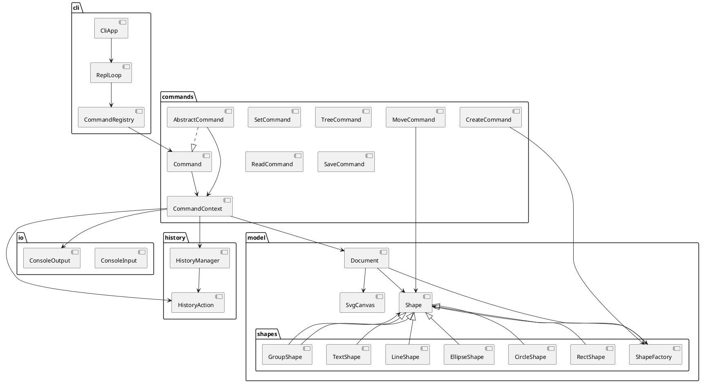

# Architecture and Phase 1 Summary

## 1. 模块划分

The project is organized into a compact layered structure that keeps the CLI, command logic, document model, and terminal I/O separated.

- `src/cli`: terminal interaction, REPL, and command dispatch.
- `src/commands`: command objects for create / move / set / delete / group / read / save / undo / redo.
- `src/model`: core SVG document state, tree-based shape lookup, canvas sizing, and serialization.
- `src/model/shapes`: concrete SVG primitives and the centralized factory.
- `src/history`: undo/redo stack for reversible edits.
- `src/io`: console adapters that isolate terminal code.
- `doc`: design decisions and process records.
- `test`: real CLI acceptance, tree-model checks, command state regressions, and Composite/factory tests.

The diagram shows representative dependencies. The CLI assembles the document, history, and output into a `CommandContext`; commands validate and apply edits through the model. Read/write filesystem calls currently live in `ReadCommand` / `SaveCommand`, while `src/io` supplies console adapters. No terminal or filesystem API is imported by the model.

## 2. 设计模式的选择

### Command Pattern
Each executable action is implemented as a class with the same command interface and is registered centrally in `CommandRegistry` instead of using a monolithic `switch` in the REPL.

Commands record `HistoryAction` closures containing stable reverse information. `SetCommand` captures old/new values once; structural edits retain parent/index; transforms retain local geometry through `captureGeometry()` so undo restores exact floating point values. History does not copy the entire document or import concrete command classes.

### Composite Pattern
`Shape` and `GroupShape` form the composite structure for SVG. Container nodes and leaf nodes share a single abstraction, which lets operations such as move, delete, and scale work on nested trees as a uniform model.

`MoveCommand` / `ScaleCommand` call `Shape.move()` / `Shape.scale()` without checking concrete types. Each leaf updates its own geometry, and `GroupShape` recursively delegates to children. Delete detaches a whole subtree through its parent.

### Factory Pattern
`ShapeFactory.create()` centralizes the type-name-to-class mapping. SVG reading delegates to `ShapeFactory.fromSvg()`, which converts attributes to the same creation entry point. Document no longer maintains a second type-to-class dispatch. Known-type construction of the document root and structural groups does not perform name dispatch.

## 3. 依赖方向规则

- `cli` may depend on `commands`, `model`, `history`, and `io` to assemble and run the application.
- `commands` may depend on `model`, `history`, and `io`.
- `model` must not depend on `cli`, `commands`, terminal IO, or the filesystem.
- `history` owns stacks of `HistoryAction` callbacks and does not import the CLI or concrete commands.
- `io` is a technical adapter and should not own business logic; read/save commands currently access `node:fs` at the application boundary.

This direction keeps geometry and document state testable without starting a terminal. Commands own validation and edit orchestration; input channels can reuse them. `CommandContext` still depends on `ConsoleOutput`, so reuse by a GUI/Agent would require an output adapter or a narrower output interface.

## 4. 变化点假设：第三次迭代与风险识别

| 未来变化 | 当前留下的边界 / 后续演化 | 风险与暂不实现的内容 |
|---|---|---|
| 新 Shape，例如后续 `box` | `ShapeFactory` 集中创建分派及 SVG 属性转换；`Shape.move/scale` 为多态操作。需求出现后再演化为 ShapeProvider / Registry。 | 创建、解析、序列化、变换的类型知识可能分散。目前序列化与 `set` 仍有类型判断；`box` 的子部件 id、属性传播、`data-kind` 读回也需设计。Phase 1 不实现插件管理器或 `box`，不能声称新增插件已能零改内核。 |
| 新 Command | `CommandRegistry` 已有集中注册及 `register()`；后续可开放给命令 Provider，完善参数描述。 | parser、help、command implementation 需要同步；只注册处理器不能保证语法与帮助自动更新。目前不引入通用 AST 或插件框架。 |
| 文档规模增大 | 当前 `findById()` 遍历唯一权威 SVG 树；真实性能测试证明瓶颈后，再考虑辅助 id index。 | 索引必须与 create/delete/group/ungroup/read/undo/redo 保持一致，不能成为第二份权威状态。现在不为尚未测出的性能问题维护缓存。 |
| CLI → GUI / Agent | Model 和 Command 不依赖 `src/cli`；新通道可直接复用核心命令和模型。 | `CommandContext` 仍绑定 `ConsoleOutput`，命令参数还是字符串数组；未来需适配输出及输入参数，当前不提前建立多通道框架。 |
| 更严格的 SVG round-trip | `Document.serializeSvg/deserializeSvg` 管理文档转换，类型创建委托工厂。 | 当前自写解析器只支持有限 SVG 子集，XML 转义、属性保真及第三方 SVG 兼容性需专门验证；六种内置类型测试不能替代完整 XML 一致性测试。 |
| 更复杂的编辑历史 | 命令保存稳定 old/new、parent/index 或局部几何恢复闭包。 | 多节点修改须完整预验证，恢复顺序及浮点精度都可能出错；不引入全文档快照框架，以具体失败测试驱动改进。 |

命令名分发和图形类型分发是当前明确保留、未来可演化的两个集中分派点；不为第三次迭代提前实现 Registry 插件基础设施。

## 5. 过程记录

The most important architectural correction in this phase was the shift from the earlier Map-based lookup idea to the final tree-first model. At one point, the document model carried a convenience lookup structure alongside the recursive tree, which created a second source of truth: the in-memory model could be traversed through the SVG tree, but a separate map introduced a hidden risk of drift and inconsistency. We explicitly treated that as a design tension rather than silently accepting it. The final decision was to make the SVG tree the authoritative state and keep `findById()` as a tree traversal helper rather than a parallel index. This made child/parent relationships, nested group operations, and move/scale semantics consistent with the actual DOM-like structure of SVG.

The process also included a concrete Git verification correction. At one point, the AI relied on a single `git push` terminal output and concluded that the complete Phase 1 implementation had been synchronized to GitHub. A human check of the remote then showed that the remote still only had the older skeleton history. We subsequently re-verified with `git rev-parse HEAD`, `git rev-parse origin/main`, `git status`, and `git log`, and also inspected the real file contents. The result was clear: the full Phase 1 implementation was still only present as working-tree modifications and had not entered any commit. That corrected the earlier conclusion and established the rule that Git status is judged using the combined evidence of commit state, remote-tracking refs, and the working tree, rather than a single terminal output alone.

### 自动测试绿，但最终人工 CLI 发现 parent 错误

此前完整测试通过后，人工执行 `create g flowchart → create rect r1 ... in flowchart → show r1`，发现 parent 仍显示 root。随后修正 `CreateCommand` 的实际插入位置，并在 `test/phase1-validation.ts` 增加 rect/text 的 `in` 场景和 `parent=g#flowchart` 断言（提交 `a0105ab`）。修复后通过 `npm test` 和真实 CLI 再验收。本次也重新执行该 CLI 场景确认归属正确。这个案例说明：已有测试全部通过，只能证明已覆盖的断言通过，不能替代最终交互验收。

### 最终审计发现 group 和 redo 状态错误

2026-10-20 的源码审计发现两处违反设计决策的实现：`group bad r1 missing` 会先摘除 r1 再报错；`set r1 x 5 → undo → redo` 会因 setter 覆盖闭包数据而回到旧值。先添加测试并确认失败，再修复：group 完整预验证后才修改树，undo 按原 sibling index 恢复；set 固定捕获 old/new，恢复操作不改历史载荷。多次 undo/redo、跨父节点恢复及失败后树不变均有回归断言。

定向审查还用失败测试确认并修正了 addto 的同父节点 redo 重复插入与环检测、ungroup 的位置恢复与根级限制。随后才集中创建分派、下移 Composite 变换，并补六种图形的 round-trip 测试；该测试额外发现并修复属性名解析漏读 `x1/y1/x2/y2`。过程依据是可复现的失败及修复后的验证，未改写旧提交历史。详细证据见 [WORKLOG.md](WORKLOG.md)。

## 6. 一致性自查

2026-10-20 人工检查实际目录、import 和关键方法，而非仅判断目录名称相符：

| 抽查项 | 实际代码及结论 |
|---|---|
| 模块职责 | `src/cli` 负责交互/分发，`src/commands` 编排编辑，`src/model` 管理文档与图形，`src/history` 管理历史，`src/io` 适配控制台。文件读写目前在 Read/SaveCommand，已在上方图文说明。 |
| Model 是否依赖 CLI | 检查 `src/model/**/*.ts` 的 import，无 CLI/Command/终端/`node:fs` 依赖。 |
| Command 是否依赖 Model | `CommandContext` 导入 Document；Create/Move/Scale 等通过文档定位并操作 Shape。Command 不导入 CLI。 |
| Shape 创建分派 | 发现并移除了 Document 中的第二套类型创建分派；`Document.createShape()` 现在委托 `ShapeFactory.fromSvg()`，最终复用 `create()` 的类映射。 |
| 命令分发 | `CommandRegistry` 集中维护命令名到 Command 的映射；REPL 不执行具体编辑业务，分词也不查询文档状态。 |
| 第二权威 Map | Document 只有 canvas/root/path 状态；`findById()` 委托 GroupShape 递归查找，没有全局 id → Shape 索引。命令注册 Map 及读入时临时 Set 不属于第二份模型。 |
| Composite 是否真正使用多态 | 审计时 Move/ScaleCommand 原有类型判断及递归；现已改为 `target.move/scale()`，Group 递归 children，leaf 修改自身几何。`captureGeometry()` 也按该树结构保存局部恢复操作。 |
| History 依赖 | HistoryManager 保存自身模块的 `HistoryAction` 回调，不导入具体 Command；命令负责提供稳定的撤销/重做闭包。 |
| 失败不改变状态与位置恢复 | group 所有目标及祖先关系先验证，原 parent/index 在修改前记录；addto 先拒绝环；ungroup 在原位置提升 children。失败、精确 sibling order 及重复 undo/redo 已测试。 |

已修正的偏差不能抹去原先问题：Map 历史张力、重复创建分派及命令层 Composite 变换均保留在过程记录中。仍存在的边界包括 `Document.serializeShape()` / `SetCommand` 的类型知识、公开几何字段及控制台输出耦合；本次没有扩展为全面封装或插件化重构。

## 7. 质量保证手段

统一入口为 `npm test`：先编译，再运行 CLI smoke、真实 CLI 功能验收，以及 `node --test dist/test/*.test.js`。原先未被执行的 `model-tree.test.ts` 已纳入；它只构造内存模型并断言，无外部副作用。

| 验证 | 实际覆盖 |
|---|---|
| TypeScript build | `npm run build`，strict 编译检查。 |
| `cli-smoke.ts` | CLI banner、提示符及 `help/exit` 启动路径。 |
| `phase1-validation.ts` | 真实 CLI 的 create-in parent、group move/scale、undo/redo、save 后 IO barrier、非法 scale、不支持的 set 属性、read 自动补 id 和警告。 |
| `model-tree.test.ts` | 嵌套 group/leaf 查找及不存在的 id。 |
| `group-state.test.ts` | 失败后 parent、sibling order、tree、SVG、history 不变；重复 id、祖先/后代、根节点拒绝；跨父节点精确撤销/重做。 |
| `set-history.test.ts` | old/new 稳定、连续多次撤销重做、独立 set 历史、未设置样式的恢复、文本保持及非法数值拒绝。 |
| `command-history.test.ts` | move/scale/delete/create/group/addto/front/back 的重复历史恢复，addto 防环与同父节点操作，ungroup 原位置提升及根级拒绝。 |
| `shape-factory.test.ts` | 六种内置类型嵌套 SVG round-trip、缺省值、可选样式、自动 id、未知标签及 Phase 1 不支持 box。 |
| `composite-transform.test.ts` | 通过统一 Shape 接口变换全部叶子类型与嵌套/空 Group；局部几何恢复、浮点值反复 undo/redo、无关 sibling 不变。 |

2026-10-20 修复后 `npm test` 通过：Node test runner 报告 32 项通过、0 失败，另有上述两个 CLI 脚本执行成功。各修复提交前后均运行 `npm test`。另经实际 CLI 进程复核 group 失败后两节点仍在、set 的 x 在 undo/redo 后为 0/5，以及 create-in 的 parent 为 flowchart。

覆盖边界需如实说明：当前脚本没有分别断言 read/init/canvas 后的 IO barrier，也不是完整 XML 或全部 Phase 1 边界条件的穷举证明。保留真实人工 CLI 验收，并根据新发现增加回归测试；不再把“测试绿”直接表述为所有行为已获证明。
