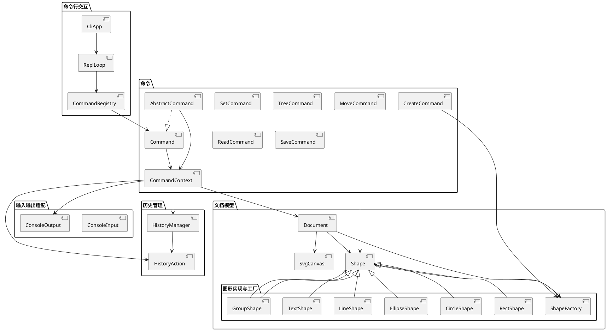

# 软件设计lab1-phase1

## 1. 模块划分

本项目按职责划分为命令行交互、命令、文档模型、历史管理和输入输出适配等模块。这样做的主要目的是把终端交互和核心 SVG 编辑逻辑分开，避免所有功能都集中在一个类中。



各目录的职责如下：

- `src/cli`：负责终端交互、REPL 循环和命令分发。
- `src/commands`：实现创建、移动、缩放、属性修改、删除、分组、文件读写、撤销和重做等命令。
- `src/model`：维护 SVG 文档状态、画布信息、图形树和序列化逻辑。
- `src/model/shapes`：实现具体图形类以及图形工厂。
- `src/history`：维护撤销栈和重做栈。
- `src/io`：封装控制台输入输出。
- `doc`：保存项目报告、设计决策和开发记录。
- `test`：保存模型测试、命令状态测试和 CLI 验收测试。

整体依赖方向可以概括为：

```text
CLI
 ↓
Command
 ↓
Model

History ← Command
IO      ← Command / CLI
```

命令行层负责组装 `Document`、`HistoryManager` 和输出通道，并把它们放入 `CommandContext`。具体命令负责参数验证和编辑流程，真正的文档和图形状态由 Model 管理。

文件读写目前由 `ReadCommand` 和 `SaveCommand` 调用文件系统完成，`src/io` 主要负责控制台适配。Model 不依赖 CLI、终端或文件系统。

---

## 2. 设计模式的选择

### 2.1 Command 模式

本项目要求支持 `undo/redo`，因此编辑操作采用 Command 模式比较自然。

每个操作都实现统一的命令接口，并集中注册到 `CommandRegistry`。这样 REPL 只负责根据命令名找到对应 Command，而不会直接包含大量具体编辑逻辑。

撤销和重做通过 `HistoryAction` 保存操作需要恢复的信息。例如：

- `set` 保存修改前后的属性值；
- 结构编辑保存原父节点和原同级位置；
- 移动和缩放保存局部几何状态。

这样做比每次复制整个 SVG 文档更轻量，也能让每个命令自己负责如何撤销自己的修改。

### 2.2 Composite 模式

SVG 本身就是树形结构，`<g>` 可以包含其他图形，因此项目中把 `GroupShape` 也设计成一种 `Shape`。

```text
Shape
├── RectShape
├── CircleShape
├── EllipseShape
├── LineShape
├── TextShape
└── GroupShape
    └── Shape[]
```

`MoveCommand` 和 `ScaleCommand` 只调用统一的：

```ts
shape.move(...)
shape.scale(...)
```

叶子图形修改自己的几何属性，而 `GroupShape` 负责递归对子节点执行操作。

这样调用方不需要到处判断“当前目标到底是普通图形还是 Group”，也更符合 Composite 模式的设计目的。

### 2.3 Factory 模式

图形创建集中在 `ShapeFactory` 中。

`ShapeFactory.create()` 负责从类型名创建对应图形，SVG 读入时也通过 `ShapeFactory.fromSvg()` 转换属性并复用创建逻辑。

这样可以避免 `rect / circle / line ...` 的类型分派散落在 CLI、Command 和 Document 中。

---

## 3. 依赖方向规则

项目中约定以下依赖方向：

- CLI 可以依赖 Command、Model、History 和 IO。
- Command 可以依赖 Model、History 和 IO。
- Model 不依赖 CLI、Command、控制台或文件系统。
- History 只管理 `HistoryAction`，不依赖具体 Command。
- IO 只负责技术层面的输入输出，不包含业务逻辑。

这样做的好处是，核心图形和文档逻辑不需要启动终端就可以测试，也方便以后替换交互方式。

目前仍有一个明确的边界：`CommandContext` 直接依赖 `ConsoleOutput`。如果后续真的增加 GUI 或 Agent 输入通道，可以再把输出进一步抽象成更通用的接口。Phase 1 暂时不提前做这一层扩展。

---

## 4. 变化点假设：第三次迭代与风险识别

如果项目继续演化，我认为下面几处最可能发生变化。

| 未来变化 | 当前设计与后续演化 | 风险 |
|---|---|---|
| 新增图形，例如 `box` | 当前用 `ShapeFactory` 集中处理图形创建；后续可以演化成 Provider / Registry 注册机制。 | 创建、解析、序列化和属性设置中仍存在一定的类型知识。`box` 还涉及内部 rect/text、属性传播和 `data-kind` 读回，Phase 1 暂时不实现完整插件系统。 |
| 新增命令 | `CommandRegistry` 已集中管理命令注册，后续可以开放给新的命令提供者。 | Parser、help 信息和 Command 实现可能出现不同步，需要进一步统一命令描述。 |
| 文档规模变大 | 当前 `findById()` 直接遍历 SVG 树。如果后续性能测试发现查找成为瓶颈，再考虑增加辅助 id 索引。 | 索引必须和 create/delete/group/read/undo/redo 始终保持一致，否则会再次出现两份状态不一致的问题。 |
| CLI 演化为 GUI 或 Agent | Model 和 Command 不依赖 CLI，因此新的交互通道可以复用核心逻辑。 | `CommandContext` 仍绑定控制台输出，命令参数目前也是字符串数组，未来需要进一步适配。 |
| SVG 兼容性要求提高 | 当前读写逻辑集中在 `Document` 和 `ShapeFactory`。 | 当前解析器只覆盖本实验需要的 SVG 子集，完整 XML 转义、更多属性和第三方 SVG 兼容性仍需要额外处理。 |
| 更复杂的编辑历史 | 当前 Command 保存旧值、父节点、位置或局部几何状态。 | 多节点操作的恢复顺序和浮点值恢复容易出错，需要继续通过具体测试完善，而不是直接改成整份 Document 快照。 |

当前保留的两个集中分派点是：

- 命令名 → Command
- 图形类型名 → Shape

Phase 1 不提前实现完整插件框架，等后续需求真正出现后再扩展。

---

## 5. 过程记录

### 5.1 从 Map 索引改为以 SVG 树为实际状态来源

项目早期曾在 SVG 树之外再维护一个 `Map<string, Shape>`，用于快速通过 id 查找图形。

在后续检查中，我发现这样会带来一个问题：SVG 树和 Map 都需要在 create、delete、group、read、undo 等操作中同时更新，一旦漏掉一个地方，就可能出现状态不一致。

因此后来决定只保留 SVG 树作为实际文档状态，`findById()` 直接从树中递归查找。

Phase 1 的图形数量并不大，所以这里优先选择实现简单和状态一致性，而不是提前优化查询性能。

### 5.2 Git push 状态误判

开发过程中曾出现一次 Git 状态判断错误。

AI 根据一次 `git push` 的终端输出判断完整实现已经同步到 GitHub，但我实际打开远端仓库后发现，GitHub 上仍然只有早期的项目骨架。

之后重新检查了：

```text
HEAD
origin/main
git status
git log
working tree
```

最后发现完整实现其实还没有 commit，只存在于本地工作区中。

这个问题让我意识到，不能只依赖 AI 对某一次终端输出的解释。之后判断 Git 是否真正同步时，会同时检查本地提交、远端跟踪分支和工作区状态。

### 5.3 自动测试通过，但人工 CLI 验收发现 parent 错误

在一次完整自动测试通过后，我又手动执行了：

```text
create g flowchart
create rect r1 ... in flowchart
show r1
```

结果发现 `r1` 的 parent 仍然显示为根节点，而不是 `flowchart`。

说明当时虽然测试通过，但实际上没有覆盖到这个具体的交互场景。

随后修正了 `CreateCommand` 的插入位置，并增加了 `create ... in <container>` 的回归测试，再重新运行自动测试和真实 CLI 验收。

这个问题也说明，自动测试只能证明已有测试覆盖到的行为正确，最终实际运行仍然有必要。

### 5.4 最终检查发现 group 和 redo 问题

后续检查中又发现了两个问题：

1. `group bad r1 missing` 在发现目标不存在之前已经把 `r1` 从原位置摘掉，导致命令虽然报错，但文档状态已经变化。
2. `set r1 x 5 → undo → redo` 后没有重新恢复成 `x=5`，说明撤销过程中修改了重做仍然需要的数据。

这两个问题都先补充了能够稳定复现失败的测试，再修改实现。

最终：

- `group` 改为先完成全部验证，再修改树结构；
- `set` 固定保存修改前后的值，undo 和 redo 不再互相覆盖数据。

进一步检查时还发现并修正了 `addto`、`ungroup` 的位置恢复，以及部分 SVG 属性解析问题。

这些修改都保留在 Git 提交历史中，详细过程见 `WORKLOG.md`。

---

## 6. 一致性自查

实现完成后，我重新检查了实际目录、import 关系和关键实现，确认当前代码与架构方案基本一致。

| 抽查项 | 结果 |
|---|---|
| 模块职责 | `cli` 负责交互，`commands` 负责编辑流程，`model` 管理文档和图形，`history` 管理撤销重做，`io` 负责控制台适配。 |
| Model 是否依赖 CLI | 检查 `src/model` 后，没有发现对 CLI、Command、控制台或 `node:fs` 的依赖。 |
| Command 是否依赖 Model | Command 通过 `CommandContext` 获取 `Document`，并调用 Model 完成真正的编辑操作。 |
| 图形创建分派 | 早期 Document 中曾存在第二套图形类型分派，后来已经统一交给 `ShapeFactory`。 |
| 命令分发 | 命令名统一在 `CommandRegistry` 中注册，REPL 不直接执行具体业务逻辑。 |
| id 查找 | 当前没有全局 `id → Shape` 权威 Map，`findById()` 直接遍历 SVG 树。 |
| Composite | `MoveCommand` 和 `ScaleCommand` 不再判断具体图形类型，而是调用统一的 `Shape.move()` 和 `Shape.scale()`；Group 自己递归处理子节点。 |
| History | `HistoryManager` 保存 `HistoryAction`，不依赖具体 Command。 |
| 失败是否改变状态 | group、addto 等结构操作先完成验证，再修改树；撤销时恢复原父节点和原同级位置。 |

检查过程中也发现，早期实现并不完全符合最初设计，例如曾存在 Map 索引、重复的 Shape 创建分派，以及 Move/Scale 在命令层判断具体类型的问题。这些后来都进行了修正。

当前仍保留一些 Phase 1 暂不继续抽象的地方，例如：

- SVG 序列化和 `SetCommand` 中仍存在少量类型判断；
- 部分几何字段仍直接暴露；
- `CommandContext` 仍绑定控制台输出。

这些属于后续迭代可以继续改进的边界，本阶段不再继续扩大重构范围。

---

## 7. 质量保证手段

项目统一使用：

```bash
npm test
```

作为主要验证入口，包括 TypeScript 编译、CLI 冒烟测试、Phase 1 功能验收以及 Model / Command 的自动测试。

主要覆盖可以分为四类：

| 验证方式 | 主要内容 |
|---|---|
| 编译与 CLI 冒烟测试 | TypeScript 编译、程序启动、提示符、`help` 和退出流程。 |
| Phase 1 功能验收 | 创建、指定容器创建、group、move、scale、set、undo/redo、save/read、错误处理等真实 CLI 行为。 |
| Model / Command 自动测试 | 树查找、失败不改变状态、父节点和同级位置恢复、Composite 行为、Factory 创建、序列化往返和历史恢复。 |
| 人工 CLI 验收 | 实际执行典型操作，重点检查 Group 的整体移动、parent 归属、undo/redo、IO barrier 和保存后的 SVG。 |

最终修复后：

```text
Node.js 自动测试：32 项通过，0 失败
CLI 测试脚本：执行成功
```

另外，开发过程中发现的 bug 都尽量补充了回归测试。例如：

- `create ... in` 的 parent 错误；
- group 失败后状态被部分修改；
- set 的 redo 状态错误；
- addto / ungroup 的结构恢复问题。

需要说明的是，现有测试并不是对所有 SVG 或所有边界情况的完整证明。例如当前 SVG parser 只覆盖 Phase 1 需要的子集，IO barrier 也没有穷举所有组合。

因此本项目仍保留人工 CLI 验收，并在实际发现新问题后补充对应的回归测试，而不是简单把“测试通过”理解为所有行为都已经完全正确。
