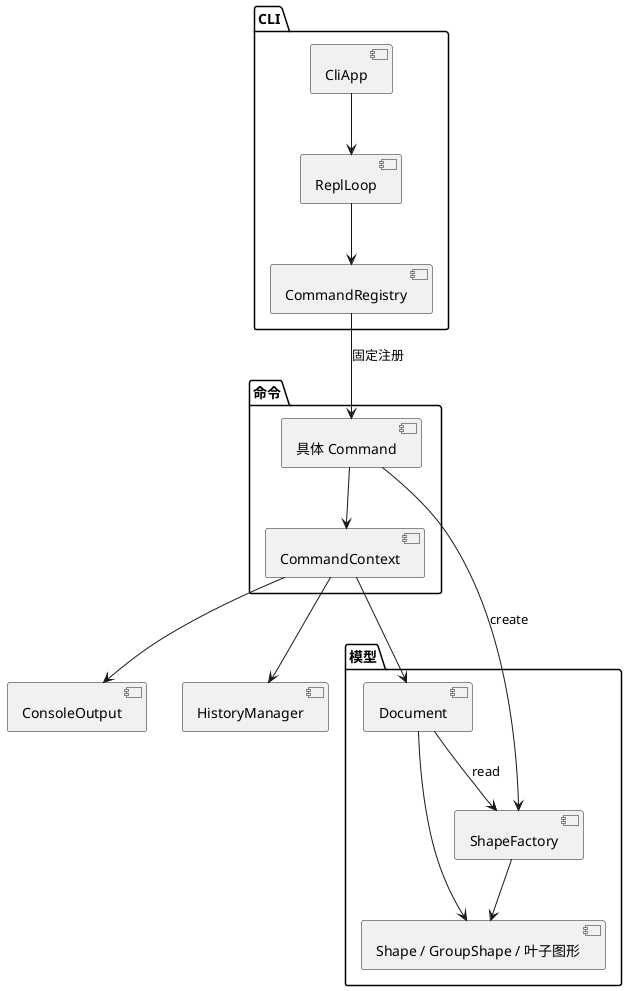
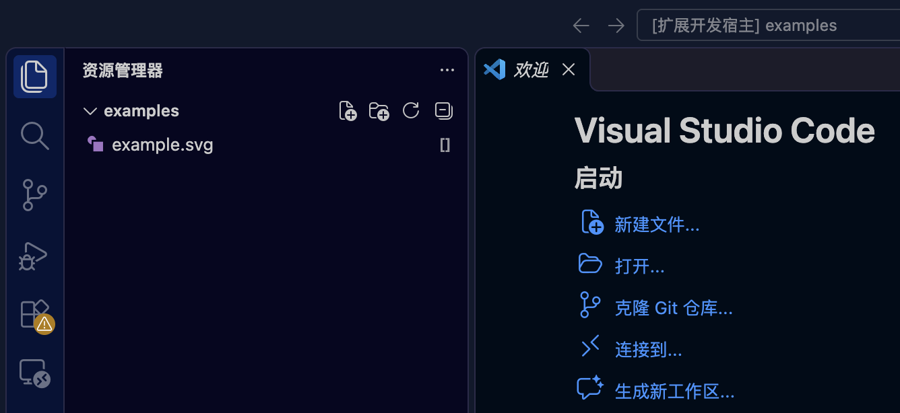
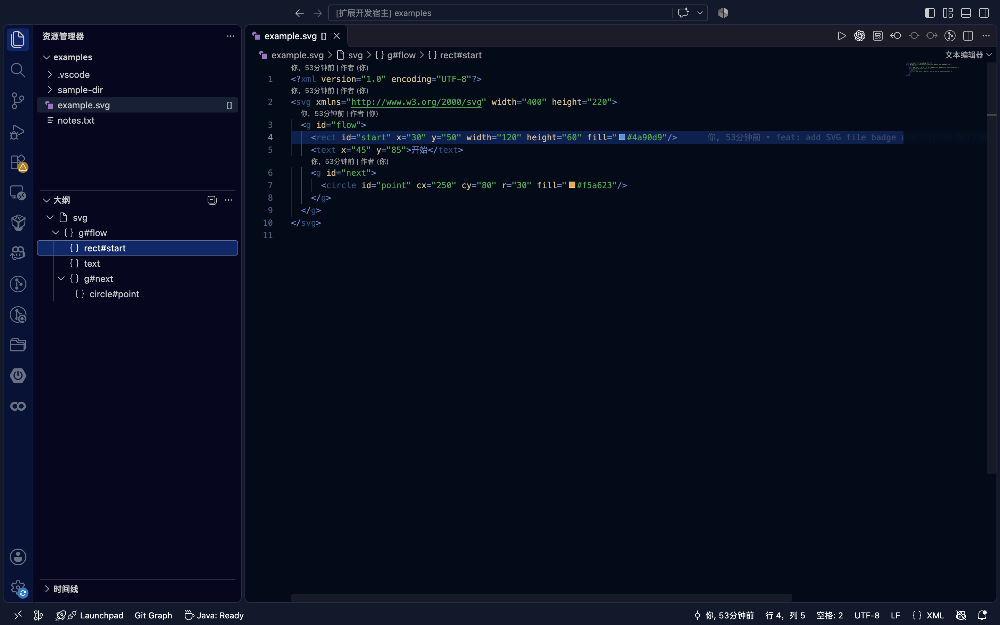
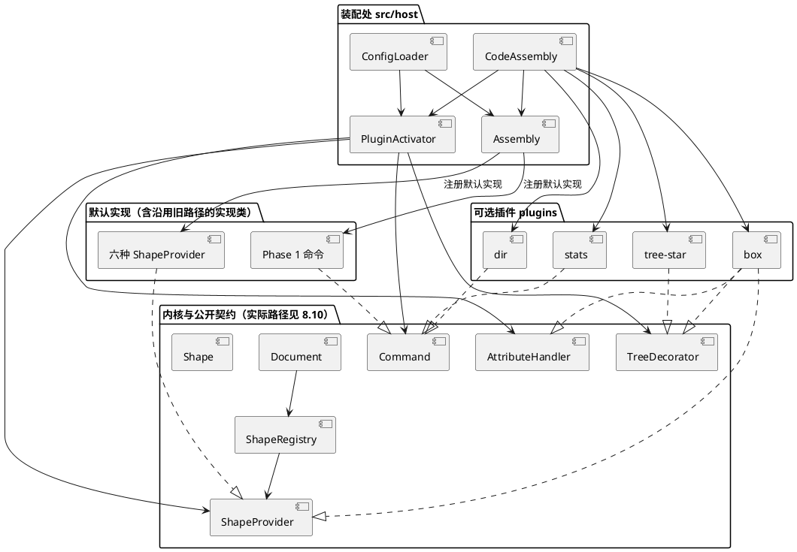

# SVG 编辑器：Lab 1 两阶段项目报告

项目使用 TypeScript 实现 SVG 命令行编辑器，随后进行 VSCode 插件开发和 CLI 插件式重构。第 1—7 节记录 `final` 对应的 Phase 1 实现，第 8 节记录 Phase 2。

Phase 2 分为两部分：先作为插件开发者使用 VSCode 的接口，再作为框架设计者为 CLI 定义扩展接口。开发日志见 [WORKLOG.md](WORKLOG.md)，课程要求见 [Phase 1](requests/lab1/phase_cli_1.md) 和 [Phase 2](requests/lab2/phase_cli_2.md)。

## 1. Phase 1：模块划分

Phase 1 将终端交互、编辑命令、文档状态和撤销历史分开，避免把所有逻辑放进 REPL。

| 目录 | Phase 1 的职责 |
|---|---|
| `src/cli` | 接收输入、解析命令、查找并执行 Command。 |
| `src/commands` | 验证参数、执行编辑或读写，保存撤销所需的信息。 |
| `src/model`、`src/model/shapes` | 维护 SVG 树、画布、具体图形和固定图形工厂。 |
| `src/history` | 保存 undo/redo 操作及文件读写后的撤销限制。 |
| `src/io` | 封装控制台输入和输出；文件读写由对应命令执行。 |
| `test`、`doc` | 保存验证用例、会话、报告和过程记录。 |

以下是重构前的依赖图；Phase 2 的对应图在第 8.2 节。



## 2. Phase 1：设计模式及理由

**Command。** 每个命令实现统一接口，REPL 只负责分发。编辑成功后记录一个 `HistoryAction`：属性修改保存前后值，结构编辑保存原父节点和同级位置，移动与缩放保存局部几何状态。这样可以精确撤销，避免每一步都复制整个文档。

**Composite。** 普通图形和分组都实现 `Shape`。Move/Scale 调用同一个方法，分组负责递归处理子节点，命令不再逐类判断图形。

**Factory。** `ShapeFactory` 集中处理图形类型名到对象的转换，创建与 SVG 读回共用这一入口。它在 Phase 1 解决重复分派问题，也成为 Phase 2 需要开放的变化点。

## 3. Phase 1：依赖方向

CLI 可以调用命令、模型、历史和输入输出；命令可以操作模型和历史。模型不引用 CLI、具体命令、终端或文件系统，历史模块不引用具体命令。`CommandContext` 仍依赖 `ConsoleOutput`，替换交互界面时需要调整这一依赖。

## 4. Phase 1：变化点与后续风险

| 预期变化 | 原设计的限制与后续方向 |
|---|---|
| 新图形、新命令 | 固定工厂和命令表需要修改；Phase 2 改为提供者和注册表。 |
| 文档增大 | `findById()` 遍历整棵树；先保证状态一致，有性能证据后再考虑索引。 |
| 更广的 SVG 兼容性 | 解析器仅支持课程子集，不能直接当作完整 XML 或 SVG 实现。 |
| 更复杂的历史与界面 | 多节点操作需测试恢复顺序和浮点状态；更换界面还需调整输出依赖。 |

## 5. Phase 1：代表性过程记录

| 发现的问题 | 如何确认与纠正 |
|---|---|
| 树外另有一份 id Map，编辑时容易不同步 | 检查 create/delete/group/read/undo 的更新路径后，改为以 SVG 树作为文档状态来源。 |
| AI 曾误判完整代码已推送 | 人工查看 GitHub 后交叉核对提交、远端跟踪引用和工作区，发现完整修改尚未提交；后续按实际引用核验同步。 |
| 自动测试通过，人工执行 `create ... in flowchart` 却显示错误 parent | 修正插入位置，并增加指定容器创建的回归测试。 |
| group 报错后已摘走部分节点；set 的 redo 值被 undo 覆盖 | 先补可复现测试，再改为结构编辑先验证、属性历史固定保存前后值；同类检查延伸到 addto/ungroup。 |

复现过程与提交记录见 [开发日志](WORKLOG.md)。

## 6. Phase 1：一致性自查

在 `final` 所对应的阶段，目录与第 1 节的职责基本一致。检查中曾发现重复图形分派、额外 Map 索引和命令按具体类型处理移动/缩放，后来分别集中到工厂、移除重复状态并交给 Shape 多态处理。

仍保留的边界是少量类型判断、部分直接暴露的几何字段以及控制台输出依赖；其中图形创建和字段封装在 Phase 2 继续调整。Phase 2 的目录与依赖检查见第 8.10 节。

## 7. Phase 1：质量保证

Phase 1 收尾时，TypeScript 编译、CLI 冒烟、课程功能验收脚本和 32 项 Node 自动测试通过。测试重点是失败后状态不变、父子关系和同级位置恢复、反复 undo/redo、六种图形的读写往返；人工 CLI 验收还发现过自动测试遗漏的 parent 问题。

Phase 2 的兼容性检查从 Git 的 `final` 对象重新构建 CLI，再与禁用可选插件后的输出逐字节比较，结果见第 8.11 节。

---

## 8. Lab 1 Phase 2：插件实践与重构

课程原文见 [Phase 2 要求](requests/lab2/phase_cli_2.md)，事先确认的设计边界见 [项目规约](PHASE2_SPEC.md) 和 [工作规范](PHASE2_WORK_RULES.md)。VSCode 扩展与 CLI 使用 TypeScript 类、接口和对象组合实现。AI 参与方案讨论和代码生成，审查中发现的问题及修改记录见第 8.9 节。

### 8.1 第一部分：作为 VSCode 插件开发者

这一部分通过文件标记和 SVG 大纲学习 VSCode 的扩展机制。插件提供文件的标记和源码中的元素信息，VSCode 决定何时请求这些信息，并负责 Explorer、大纲和源码跳转的显示与交互。

**注册与调用过程。** 扩展宿主提供运行环境，在扩展启动时调用 `extension.activate(context)`。其中实例化 `SvgFileDecorationProvider`、`SvgDocumentSymbolProvider` 两个类，分别调用 `registerFileDecorationProvider()`、`registerDocumentSymbolProvider()`；注册返回的释放对象存入 `context.subscriptions`，由宿主管理生命周期。

随后，Explorer 需要装饰 URI 时回调 `provideFileDecoration(uri)`，大纲需要更新时回调 `provideDocumentSymbols(document, token)`。前者确认实际文件类型后返回 `[]`，后者把当前文本转换为嵌套的 `DocumentSymbol`。源码范围由插件提供，选择和滚动由 VSCode 执行；编辑后宿主重新请求符号，遇到不完整 XML 时提供者返回空列表。

**文件标记。** Explorer 中 `example.svg` 右侧显示 `[]`，文件名保持不变。



图 1：扩展开发窗口中的文件标记，摄于 2026-11-12。

**大纲与源码定位。** 左下方大纲展示 `svg → g#flow → rect#start`，包含无 id 的 `text` 和嵌套组。点击 `rect#start` 后，右侧源码定位到第 4 行。同一张图中的 `notes.txt` 和目录均没有 `[]` 标记。



图 2：扩展开发窗口中的嵌套大纲与源码定位，摄于 2026-11-12。两图记录细节优化前的界面，新增摘要、角色图标和悬浮提示未在图中展示。

**文件装饰与设计模式。** 经典 Decorator 通常与被装饰对象实现同一接口，内部持有该对象，并把原有调用转交给它。本项目的提供者实现的是 VSCode 的 `FileDecorationProvider` 接口，返回 `FileDecoration` 数据；它没有持有一个“原文件对象”并转发文件读写。VSCode 持有注册的提供者，将返回的 badge 与 Explorer 项合成显示。两者的共同点是为原对象增加显示信息，差别在于这里组合的是显示数据，经典 Decorator 包装的则是对象及其调用。装饰过程不改变文件名和内容。

提供者也承担了数据转换：把 URI、文件类型转换为 VSCode 的显示数据。它与 Adapter（适配器）的相似之处在于衔接接口；差别是这里通过宿主回调返回数据，没有包装旧接口对象来转发操作。CLI 中的 `NodeDirectoryAdapter` 则把 Node 文件系统 API 转换为 `DirectoryAccess`，由 `DirCommand` 通过构造参数接收，见第 8.5 节。

**Phase 1 代码能否复用。** 逐一评估后，扩展没有直接引用 CLI 的运行代码：

| 既有内容 | 评估与选择 |
|---|---|
| `Document.deserializeSvg()` | 服务于可编辑模型，只覆盖有限 SVG 子集，未保留标签偏移。直接复用无法精确定位源码，还会把内置图形注册和文档状态带入扩展。大纲另用 `SvgOutlineParser` 保存源码范围。 |
| `Shape`、`GroupShape` | 负责几何修改、结构约束和序列化；大纲需要的是标签、id、显示摘要及源码范围。共用这些类会使大纲同时依赖几何状态、编辑规则和内置图形。 |
| 树遍历 | 深度遍历和递归构造子节点的思路可复用，但具体对象不同：CLI 遍历 Shape，大纲递归转换 SvgElement。两处各自实现遍历，没有共用模块。 |

**源码、启动与演示。** 源码在 [vscode-extension/src](../vscode-extension/src/extension.ts)，示例为 [example.svg](../vscode-extension/examples/example.svg)，完整启动步骤见 [扩展 README](../vscode-extension/README.md)。在仓库根目录安装锁定依赖并构建后，可用开发宿主运行，不要求先打包安装 VSIX：

```bash
npm ci
npm run build:vscode
code --new-window --extensionDevelopmentPath="$PWD/vscode-extension" "$PWD/vscode-extension/examples"
```

Explorer 应只给 SVG 文件显示 `[]`；以文本编辑器打开示例，展开大纲后点击 `rect#start` 应定位第 4 行。编辑器默认关联需要为文本编辑器，避免跳到图片预览。实际的 [文件标记截图](evidence/lab2/vscode-svg-badge.png) 与 [大纲定位截图](evidence/lab2/vscode-svg-outline.png) 已提交；它们记录原版界面，新摘要、图标与悬浮提示的版本范围见 [证据说明](evidence/lab2/README.md)。自动测试覆盖嵌套、无 id、编辑更新、不完整 XML 和源码范围。API 依据见 [VSCode 官方文档](https://code.visualstudio.com/api/references/vscode-api)。

### 8.2 第二部分：作为 CLI 框架设计者

第一部分使用 VSCode 已定义的接口；这一部分转为定义稳定接口，让新的图形、命令、树标签和属性语义可以追加。新增插件通过装配位置接入，Document、Set 和 Tree 命令通过接口调用它。

重构前的图在第 1 节：工厂和命令表知道全部具体类型。下面是重构后的图：领域代码只按接口调用，默认实现和可选插件通过外层装配接入。图中的“内核”按职责划分，部分公开接口仍沿用旧目录，实际路径见第 8.10 节。



`src/model/shapes/GroupShape.ts` 是公开的 Composite 容器抽象；其余五种叶子实现虽沿用 Phase 1 路径，已由 `src/builtin/shapes/` 的提供者装配。插件可以使用 `Shape`、`GroupShape`、`CommandContext` 及扩展接口，不导入内置叶子类、宿主或其他插件。`CodeAssembly.ts` 是代码装配唯一需要改的入口；配置加载器不含任何插件名称分支。图中的实现箭头对应包内的 Command、Provider、Handler 和 Decorator 类。

### 8.3 四个扩展点清单

| 扩展点接口及职责 | 内核调用位置 | 已有实现 | 关闭可选插件后的行为 | 违反契约的处理 |
|---|---|---|---|---|
| [ShapeProvider](../src/core/ShapeProvider.ts)：创建及读回一种图形 | [ShapeRegistry.ts](../src/core/ShapeRegistry.ts) 的 `create()/read()`，由 [Document.ts](../src/model/Document.ts) 的 `makeShape()/deserializeSvg()` 调用 | 六种内置提供者，`BoxProvider` | 六种原有图形可用；`create box` 报未知类型，带 `data-kind="box"` 的 `<g>` 降级为普通组 | 重名拒绝注册；创建返回错误 id/类型时报 `invalid shape provider`；读回异常使整次读取失败且旧文档保留 |
| [Command](../src/commands/Command.ts)：提供命令名、帮助文案与执行行为 | [CommandRegistry.ts](../src/cli/CommandRegistry.ts) 的 `execute()`；[HelpCommand.ts](../src/commands/HelpCommand.ts) 的 `execute()` 枚举可用命令 | Phase 1 内置命令；独立插件 `StatsCommand`、`DirCommand` | 两个新增命令均报 `unknown command`，`help` 无它们 | 重名拒绝注册；执行抛错报 `command failed: ...`，REPL 继续运行 |
| [TreeDecorator](../src/core/TreeDecorator.ts)：给结构树标题行追加标签 | [TreeDecoratorRegistry.ts](../src/core/TreeDecoratorRegistry.ts) 的 `decorate()`，由 [TreeCommand.ts](../src/commands/TreeCommand.ts) 的 `execute()` 调用 | `BoxTypeDecorator`、`ModifiedStar` | 不追加任何标签；Lab 1 树输出逐字节不变 | 重名拒绝注册；抛错或返回非字符串时报 `tree decorator failed: ...` |
| [AttributeHandler](../src/core/AttributeHandler.ts)：定义某图形的属性修改语义 | [AttributeRegistry.ts](../src/core/AttributeRegistry.ts) 的 `matching()` 与 [SetCommand.ts](../src/commands/SetCommand.ts) 的 `execute()` | `BoxAttributeHandler` 处理 box 的 `fill`/`label` | 默认仍按图形自身允许属性处理；未知属性报 `unknown attribute` | 重名拒绝注册；同时命中拒绝执行；部分修改后抛错由 `AttributeTransaction.rollback()` 恢复，历史不变 |

注册先暂存，再比较清单及已有注册；成功才发布。一个插件激活失败不会留下它的任一注册，已成功插件和后续插件照常工作。插件的 `activate()` 契约限定为注册扩展；加载器无法撤销插件自行写入外部文件等不受管理的副作用。

### 8.4 两种装配与配置格式

代码装配由 `src/host/CodeAssembly.ts` 显式导入插件并调用 `PluginActivator.activate()`；配置装配由 `src/host/ConfigLoader.ts` 读取根目录 [plugins.config.json](../plugins.config.json)，按数组顺序解析模块并调用同一个激活器。`enabled: false` 完全跳过，`options` 原样传入插件的 `activate(context, options)`。相对路径以配置文件目录为准；包名使用 Node 当前环境的模块解析规则。`box` 的 `options.fill` 可修改新建 box 的默认填充色。

```json
{
  "plugins": [
    { "module": "./plugins/stats" },
    { "module": "./plugins/dir" },
    { "module": "./plugins/box", "options": { "fill": "#4a90d9" } },
    { "module": "./plugins/tree-star", "enabled": true }
  ]
}
```

运行 `node dist/src/cli/CliApp.js` 使用代码装配，`node dist/src/cli/CliApp.js --config plugins.config.json` 使用配置装配，`--no-plugins` 仅启用默认能力。配置无效时输出 `error: invalid plugin config` 并以默认能力启动；模块不存在、无默认导出、声明与注册集合不一致、激活抛错及重复注册分别按要求输出明确错误。`ConfigLoader` 的模块求值失败单独归入激活失败，不误报为顶层模块不存在。加载器没有硬编码具体插件导入、名称映射或类型分支。

| 加载失败 | 对用户的反馈（均以 `error:` 开头） |
|---|---|
| 顶层模块找不到 | `plugin not found: <module>` |
| 没有默认导出 | `plugin has no default export: <module>` |
| 清单与实际注册不符 | `plugin manifest mismatch: <name> (declared: …, registered: …)` |
| 模块求值或激活抛错 | `plugin failed to activate: <name> (<reason>)` |
| 同类同名重复 | `duplicate registration: <category>/<name>` |
| 配置语法或结构错误 | `invalid plugin config` |

### 8.5 `stats`、`dir` 与 `box`

`stats` 从画布子节点按当前顺序深度优先遍历，普通组和 box 只增加容器数，内部叶子分别计数。类型顺序是第一次遇到的顺序，空文档输出 `(total 0, containers 0)`。命令只读文档，不入历史。`dir` 在 `init/read` 前也可运行，不受当前 SVG 路径影响，不更改 undo/redo 或 dirty 状态；它只读取当前进程工作目录的直接子项，目录在前，名称升序，包含隐藏项。符号链接和其他非目录项不跟随目标，统一按 `[FILE]` 显示。

| 适配器模式角色 | 本项目对象 | 职责 |
|---|---|---|
| Client | `DirCommand` | 只依赖统一目录访问接口并负责排序、格式和错误反馈。 |
| Target | `DirectoryAccess` | 定义 `list(path)` 及独立于 Node 的 `DirectoryEntry`。 |
| Adapter | `NodeDirectoryAdapter` | 调用 Node 文件系统 API，将 `Dirent` 转为目标接口。 |
| Adaptee | Node `readdirSync` / `Dirent` | 提供真实目录数据。 |

`box` 插件经 `PluginContext.createShape()` 生成内置 `rect`/`text` 子部件，内部 id 分别为 `<id>-rect` 和 `<id>-label`；整个新子树的 id 在插入前统一查重。它可在 `g` 或另一 box 内创建、整体移动、分组和删除；`ungroup box` 与直接删除、移走其必要子部件均拒绝。序列化保留 `data-kind="box"`。已装插件读到残缺或错误类型的 box 会拒绝整次读入，重复 id 同样拒绝；未装插件则按普通 `g` 读回，保留 `data-kind` 元数据以供以后恢复。

### 8.6 ADR：项目自行规约的语义

**ADR 1：属性处理冲突及事务。** 可选方案为拒绝冲突、优先级或组合执行。本项目拒绝多个处理器同时命中，避免注册顺序成为隐含语义。处理器只通过 `Shape` 公开方法和 `AttributeTransaction.set()` 修改字段；事务按修改顺序记录前后值，一条成功的 `set` 只写入一条历史操作。处理器在部分修改后抛错时，逆序回滚且不写入历史；失败不回退到默认属性处理。测试用先改 `x` 再抛错的处理器验证文档和历史都不变。

**ADR 2：box 的读回与结构不变量。** 可选方案为拒绝残缺 box 或警告降级。本项目在插件已装时拒绝整个读入，避免把不完整对象当作 box；插件未装时按普通组降级。必要子部件必须是直接子节点，id 和类型均正确；普通结构命令不得将其摘出。全局重复 id 在降级前仍必须拒绝。选择严格读回的代价是有缺陷的外部 SVG 需要先修正才能导入。

**ADR 3：dirty 与树标签。** 可选方案为比较保存点内容或只记录发生过编辑。本项目比较最近一次成功 `save` 的内容，`init/read` 视作新基线；新节点立即标星，undo 回到保存点时星号消失。子树内容差异使祖先及 SVG 根行也标星；同一行的 `(box)` 排在 `*` 前。`ModifiedStar` 自己保存快照，未给 `Document` 加全局 dirty id 集合。树展示时需要比较子树序列化结果，尚未进行大文档性能测试。

**ADR 4：清单校验时机。** 可选方案是边激活边公开注册，或先暂存后校验。本项目先将所有注册暂存在本次激活上下文；检查重复名与 `contributes` 四类名称集合后才逐类发布。因此清单不一致、重复或激活抛错不会污染已有注册。插件激活顺序由配置数组决定，失败后继续加载下一项。

### 8.7 过程节点与指标

开发按普通提交推进：`68cce65` 建立扩展，`334f72e` 建立四个扩展点并产出首轮指标，`9108a13` 接入 stats/dir，`0fb561a` 和 `16b1237` 分别验证 box 的代码/配置装配，`1162d7f` 接入星号标签。后续审查修正以普通提交追加。

代码装配的 box 接入提交只新增插件包、修改 `CodeAssembly.ts` 和加入测试；配置装配的接入提交只改配置与测试。本轮重新检查了父版本目录确实存在，再对内核和既有插件执行差异检查，结果为空。tree-star 允许修改顶层装配与配置，对内核和渲染命令的差异同样为空。具体复核命令见 [抽查记录](evidence/lab2/quality-audit.md)。

[指标目录](../docs/metrics/README.md) 保存从 Git 对象生成的文件清单、职责、分类行数与复杂度估算；脚本为 [generate-metrics.js](../scripts/generate-metrics.js)，测试、依赖和构建产物排除，VSCode 扩展单列。交付摘要对照 `final` 与 `p2`，CLI 分类行数为内核 764、装配处 315、插件 1601；扩展为 5 个源码文件、189 行。生成方法见指标目录。

交付标记为 `p2`，正式文件清单是 `files-final.tsv` 与 `files-p2.tsv`。`files-main.tsv` 保留分支收尾时的快照。指标先从待发布源码生成，建立 tag 后使用同一命令重跑核对。

### 8.8 现有功能的细节设计（2026-11-13）

2026-11-13 调整了大纲显示、文件标记提示和示例 SVG，六项修改分别提交。CLI 行为与输出保持不变。

| 细节 | 处理方式与理由 | 例子与验证 |
|---|---|---|
| 大纲摘要 | 名称显示标签和 id，detail 补充显式几何属性或文字。尺寸取自源码属性，不计算 CSS 或变换结果。文字最多 32 个 Unicode 字符，合并空白并解码实体，避免长文占满侧栏。 | 新示例的 `rect#start` 名称保留，旁边显示 `160 × 64`；无 id 的 `text` 显示 `“用户提交”`。自动测试覆盖嵌套 tspan、CDATA、实体、空文本、缺少属性和 emoji 截断。 |
| 原生图标 | 根、容器、图形和文字使用 File、Array、Object、String。将容器视为元素集合，结合缩进判断角色；保留主题提供的颜色和图标。 | `g#next` 与 `g#result` 使用容器图标，`rect#review` 与文字节点类型不同；测试同时覆盖 defs/clipPath、tspan 和未知元素的回退。 |
| 定位范围 | selectionRange 选中起始标签，range 包含完整元素及其子树。点击容器时可以直接修改其属性，同时保留正确的子树归属。保留原有实现，补充范围测试。 | 新增 LF/CRLF、多行标签、属性中的 >、注释假标签和中文/emoji 的行列与包含关系测试；已有真实截图证明原生导航可定位源码。 |
| 标记提示 | `[]` 保持课程要求，悬浮提示解释它是 SVG 源文件，并指出可在大纲查看结构。提示放在已有标记上，悬浮时显示。 | 提示为“SVG 源文件 · 可在大纲中查看元素结构”；继续只对实际 SVG 文件提供装饰，不读写 SVG 内容。 |
| 示例 SVG | 用“提交—审核—完成”表达流程，统一 160 × 64 圆角框和 100 单位间距，蓝/橙/绿表示输入/处理/完成；同时使用编号和文字，避免仅以颜色传意。 | `rect#start` 仍在第 4 行；嵌套组和无 id 文字均保留。XML、id 唯一性、大纲解析通过，独立临时 Chrome 配置离线渲染确认了中文、箭头和布局。 |
| 材料版本 | 截图标注对应的界面版本，指标记录生成时读取的 Git 引用。 | 旧截图保留原文件；交付指标读取 `final/p2`，分支快照保存在 `files-main.tsv`。 |

原生 detail、kind、range 和 selectionRange 的职责依据 [VSCode DocumentSymbol API](https://code.visualstudio.com/api/references/vscode-api#DocumentSymbol)。摘要颜色、图标外观、选中和滚动效果由 VSCode 主题与原生视图处理，插件不固定配色或替换 Outline。

测试结果见第 8.11 节。摘要、图标和悬浮提示尚未补录新截图。

### 8.9 过程记录

**box 插件的依赖修正。** AI 最初生成的 box 插件通过了功能测试，但直接导入内置 `RectShape`、`TextShape`，违反“插件只依赖公开领域接口”的方案。检查 import 后，提交 `7c32892` 将子部件创建改为调用 `PluginContext.createShape()`，属性访问改用 Shape 的公开方法。修改后重新运行了读回、属性、配置和会话测试。

**残缺 box 的读取反馈。** 模型能拒绝残缺 box，但 CLI 将内容错误与文件读取失败混为笼统反馈。提交 `e6619b7` 补充了具体原因，并通过临时文件测试 ReadCommand：报错包含 box 的问题，旧文档和历史保持不变。

**SVG 默认编辑器关联。** 最初环境无法访问图形桌面，先依据 API 实现并做模拟测试。在扩展开发窗口中操作时，大纲树已显示，点击却切到 SVG 图片预览。检查后确认是文件的默认编辑器关联导致；`2c15ac9` 为示例工作区设置文本编辑器并补充启动说明。再次操作时，选中 `rect#start` 后源码停在第 4 行，结果保存在大纲截图中。

**界面细节的范围调整。** AI 起初建议增加变更清单、对齐等功能，讨论后确定只调整现有功能。随后用六个独立提交完成大纲摘要、角色图标、定位测试、标记提示、示例视觉和材料说明。定位算法保留，新增了多行标签和不同换行格式的测试。

**历史状态测试补充。** 从 `49c7a48` 开始抽查代码时，原测试通过，但没有直接覆盖两种组合：dir 成功或失败时保留已有 redo；属性处理器修改多个子部件及重复写入同一属性后抛错。新增测试验证了状态恢复和 redo 保留，均通过。测试与抽查记录提交为 `36dab48`，运行代码未作修改。

### 8.10 一致性自查：目录和依赖是否符合方案

**模块划分。** 按方案新增了 `src/core`、`src/builtin`、`src/host`、`plugins` 和 `vscode-extension`。部分接口和图形类沿用 Phase 1 的路径，目录差异如下：

| 实际位置 | 架构中的角色与沿用理由 |
|---|---|
| `src/core`，以及 `src/model/Document.ts`、`Shape.ts`、`shapes/GroupShape.ts` | 扩展契约、注册表、领域状态及公开容器抽象；插件通过规约列出的公开 API 使用这些类型。 |
| `src/commands/Command.ts`、`CommandContext.ts` | Command 接口与公开上下文沿用旧路径；同目录中的具体命令属于默认实现。 |
| `src/cli/CommandRegistry.ts` | 仍放在 CLI 目录，但负责统一注册和分发，不再固定构造具体命令。宿主使用它装配，插件不导入它。 |
| `src/builtin/shapes/` 与旧 `src/model/shapes/` 的五种叶子类 | 提供者新增在 builtin，原有叶子类保留旧路径，由提供者装配。可选插件不直接导入这些实现类。 |
| `src/host`、`plugins/*`、`vscode-extension` | 分别承担启动装配、可选扩展和编辑器实践；插件互不导入，编辑器扩展也不引用 CLI 模型。 |

**依赖方向：早期 box 曾违反规则，修正后本轮抽查未再发现同类违规。** 检查脚本遍历 76 个 TypeScript 源文件的 229 处字面量模块引用，按规约检查领域层、插件公开 API、插件之间和编辑器扩展的边界；唯一动态加载位于通用 `ConfigLoader`，同时人工检查了该实现没有具体插件映射。抽样检查的调用关系为：

- `BoxProvider → ShapeProvider / Shape + 注入的 createChild`：通过公开接口创建和使用子部件，不直接引用内置叶子实现。
- `DirCommand → DirectoryAccess ← NodeDirectoryAdapter → node:fs`：命令依赖目录接口，适配器负责技术实现。
- `extension.activate → 两个 Provider → vscode API`：扩展与 CLI 各自运行，未引入跨端模型依赖。

[检查脚本](../scripts/audit-dependencies.js)还通过三类内存错误注入核验会拒绝违规引用。检查范围是静态模块引用，动态调用由源码抽样和行为测试补充。公开 API 的路径、扫描范围与限制见 [质量抽查记录](evidence/lab2/quality-audit.md)。

### 8.11 质量保证手段

2026-11-13 先进行代码抽查，再运行测试和会话比较。两套 TypeScript 配置均开启 strict。复核命令如下：

```bash
node scripts/audit-dependencies.js
npm test
node scripts/verify-transcripts.js
node scripts/generate-metrics.js final p2
```

验证范围和结果如下：

| 手段 | 验证内容与本轮结果 |
|---|---|
| 编译与功能测试 | CLI 54 项、VSCode 11 项通过，0 失败；另有 CLI 冒烟与 Phase 1 验收脚本成功。覆盖正常操作、错误反馈、状态保持、undo/redo 与编辑中的大纲输入。 |
| 插件与故障测试 | stats、dir、box、tree-star 可单独测试；dir 有接口替身和真实临时目录；加载器有找不到模块、无默认导出、清单不符、激活抛错、重复注册和失败回滚；属性处理有冲突与部分修改后失败的验证。 |
| 运行会话对比 | 从 `final` Git 对象重建基线，关闭可选插件的基础会话输出逐字节一致；同样环境下的基础、box、stats/dir 三组代码/配置装配输出也逐字节一致。目录内容固定，日志不写入被列出的目录。 |
| 源码与界面 | 检查模块引用、关键调用和插件接入提交的差异；VSCode 截图记录原版标记、大纲与定位，新示例经浏览器离线渲染检查。 |

新增的两项测试还检查了历史栈非空时的行为：目录命令不改变 dirty、SVG 路径和工作目录；属性失败逆序恢复多个子部件及同一属性的重复修改，既有 redo 仍然可用。测试步骤和结果见 [代码抽查记录](evidence/lab2/quality-audit.md)。

测试使用课程定义的 SVG 子集，未测量覆盖率或大文档性能。扩展单元测试使用模拟的 vscode 模块与最小 API 类型声明，宿主版本差异仍需在 VSCode 中验证。加载器的回滚范围是注册表，不包括插件自行写入的外部文件。

新增摘要、图标和悬浮提示尚未补录界面截图。

### 8.12 交付物核对

| 课程要求 | 材料与状态 |
|---|---|
| 同一个远程仓库及最终 `p2` | 仓库为 `NinaZ65/sd-svg-lab`，Phase 1 的 `final` 保留。交付版本使用 `p2` 标记。 |
| 两部分源码及启动材料 | [VSCode 扩展说明](../vscode-extension/README.md)、[扩展入口](../vscode-extension/src/extension.ts)、[示例 SVG](../vscode-extension/examples/example.svg)；CLI 内核、默认实现、宿主与四个插件均在同一仓库。 |
| 正式报告 | 本文件；第 8.1 节是插件开发与模式、复用分析，第 8.2—8.6 节是 CLI 架构、扩展点、双装配及四条 ADR，第 8.9—8.11 节是过程、一致性与质量保证。 |
| 文件清单和重构指标 | [docs/metrics](../docs/metrics/README.md) 和生成脚本随源码提交，正式指标比较 `final` 与 `p2`，VSCode 扩展单列。 |
| 独立测试、会话与证据 | [会话材料](transcript/README.md)、[截图及版本说明](evidence/lab2/README.md)、[代码质量抽查](evidence/lab2/quality-audit.md)。 |
| 简短提交说明与旧材料 | [Phase 2 提交说明](submissions/lab1-phase2/提交说明.md)列出报告路径 `doc/README.md`；Phase 1 的原说明和 PDF 保存在 `doc/submissions/lab1-phase1/`。 |
